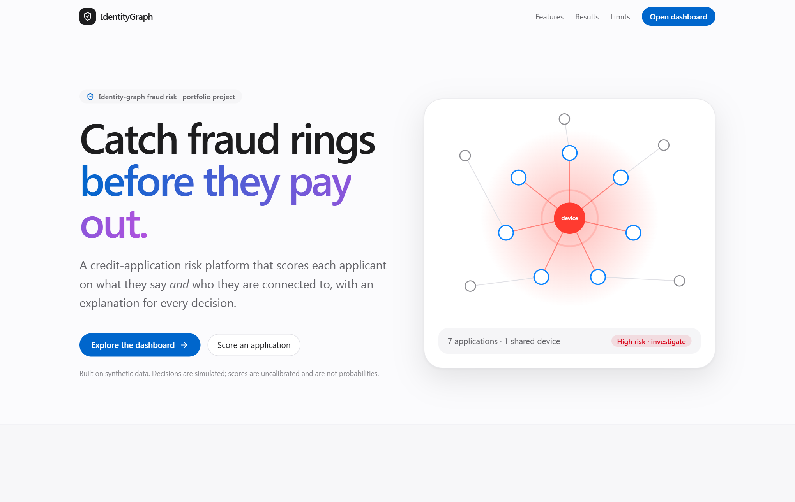
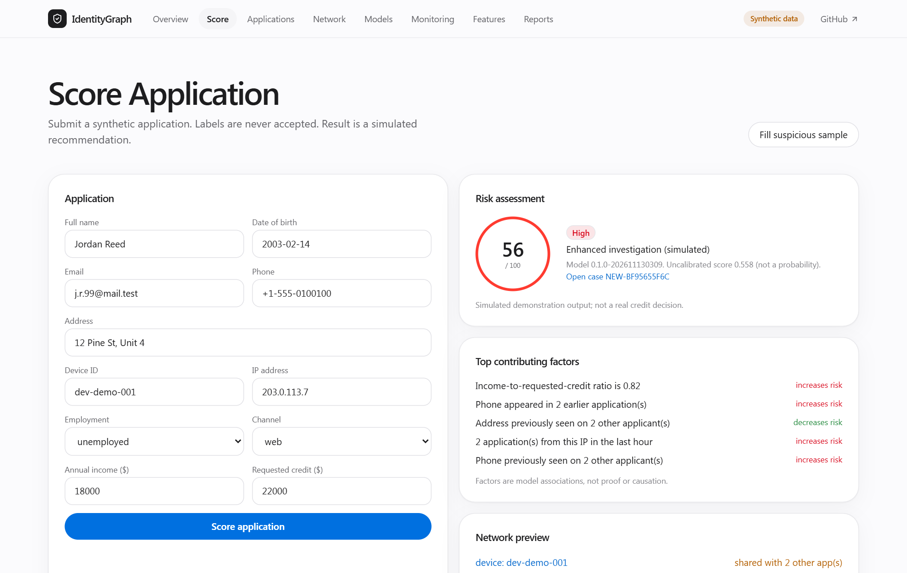
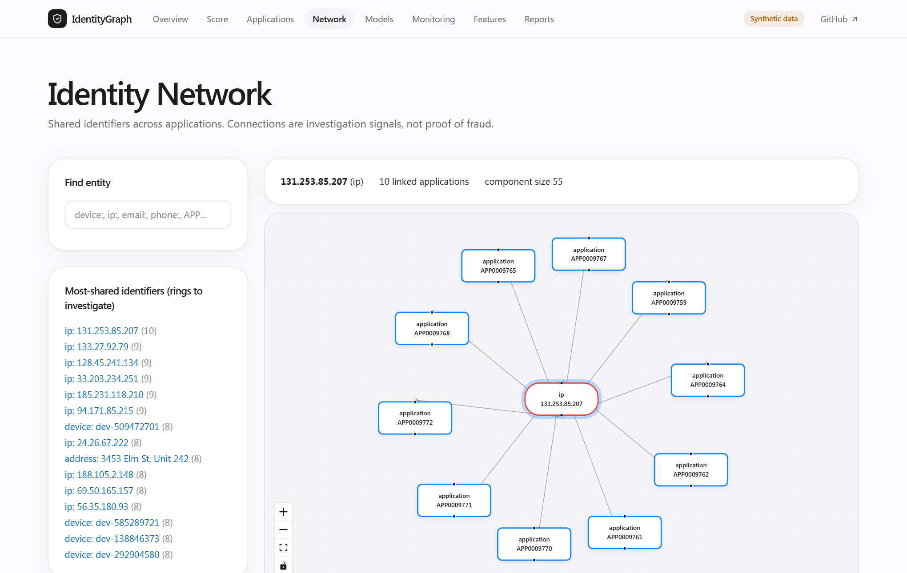

# IdentityGraph AI

[](https://github.com/ragurajakrishnan15/identitygraph-ai/actions/workflows/ci.yml)

**Identity-graph fraud risk for credit applications.** It generates synthetic applications, engineers leakage-safe
identity / device / velocity / graph features, trains and compares eight models, serves explained scores through a FastAPI
API, monitors drift, and lets an analyst investigate rings of linked applications in a Next.js dashboard.



> **All data is synthetic and all decisions are simulated.** This is not a real credit-decision system.
> Graph links are investigation signals, not proof of fraud. Scores are **uncalibrated** (not probabilities).

## What it shows

| | |
|---|---|
| **Graph features that matter** | Applications are linked through shared device, IP, phone, email and address. Graph features lift PR-AUC by ~+0.015 in all three boosting families (see caveat below). |
| **Leakage discipline** | Chronological 60/20/20 split, point-in-time features, labels used only after a maturity lag, thresholds picked on validation only. Tests fail if future information leaks. |
| **Explainability** | SHAP factors per application, worded as associations, never proof. |
| **Product engineering** | FastAPI (route → service → repository), SQLAlchemy + Alembic migrations, Next.js 14 dashboard, Docker Compose, CI, 22 backend tests + 24 browser checks. |
| **Honesty** | Limits are stated in the UI, the model card and this README. |

| Score an application | Identity network |
|---|---|
|  |  |

## Results (chronological hold-out, 4,000 synthetic applications, 377 fraud)

| Model | PR-AUC | ROC-AUC | Recall @ 1% FPR |
|---|---|---|---|
| logistic_regression | 0.755 | 0.897 | 0.509 |
| random_forest | 0.819 | 0.913 | 0.753 |
| gradient_boosting | 0.830 | 0.924 | 0.732 |
| **graph_gradient_boosting** (primary) | **0.845** | 0.923 | 0.772 |
| xgboost / graph_xgboost | 0.829 / 0.845 | 0.917 / 0.921 | 0.743 / 0.777 |
| lightgbm / graph_lightgbm | 0.828 / 0.844 | 0.919 / 0.920 | 0.743 / 0.775 |

**Read these carefully.** Data is synthetic, so numbers are optimistic. It is a single seed with no confidence intervals. The graph lift
depends on the label-maturity lag (7 days), which I set after seeing that a 30-day lag made the feature almost always zero. That choice was
informed by test-period results, so treat the lift as indicative, not a clean held-out estimate. The full story, including an incorrect first
diagnosis, is in [reports/model_card.md](reports/model_card.md).

## Architecture

```
generator -> validation -> feature pipeline (point-in-time) -> chronological split -> 8 models
                                  |                                        |
                         union-find graph features               thresholds (validation only)
                                  v                                        v
 SQLite/Postgres <- seed <- artifacts (model.joblib, metrics.json, monitoring.json)
        |
 FastAPI (route -> service -> repository) -> Next.js dashboard (API client + labelled mock fallback)
```

| Path | Purpose |
|---|---|
| `src/identitygraph/` | data, features, graph, models, evaluation, explainability, monitoring, decisioning |
| `backend/app/` | FastAPI app, services, SQLAlchemy repositories, API tests |
| `alembic/` | versioned database migrations (run on container start) |
| `frontend/` | Next.js (App Router) + Tailwind + Framer Motion + Recharts + React Flow |
| `configs/` | data, features, model, thresholds, app YAML |
| `scripts/` | generate / validate / build_features / build_graph / train / evaluate / batch_score / seed_db / make_notebooks |
| `notebooks/` | executed exploration, feature analysis and model-experiment notebooks |
| `reports/` | data card, model card, evaluation summary |

## Run it

**Docker (everything, one command):**
```bash
docker compose up --build        # Postgres + API (model is built into the image) + UI
# UI http://localhost:3000   API docs http://localhost:8000/docs
```

**Locally:**
```bash
python -m venv .venv && .venv\Scripts\Activate.ps1     # source .venv/bin/activate on Linux/macOS
pip install -r requirements-dev.txt
python scripts/generate_data.py && python scripts/validate_data.py
python scripts/train.py && python scripts/evaluate.py && python scripts/seed_db.py
uvicorn backend.app.main:app --reload --port 8000
cd frontend && npm install && cp .env.example .env.local && npm run dev    # http://localhost:3000
```
`make` targets mirror these. Without a running API the UI shows a clear **"SIMULATED mock data"** banner (mock data lives only in `frontend/lib/mock-api.ts`).

## Deploy
Frontend on **Vercel**, backend on **Render** (free Docker service). Step by step: [docs/DEPLOYMENT.md](docs/DEPLOYMENT.md). `render.yaml` and `frontend/vercel.json` are included.

## API (`/api/v1`)
`GET /health`, `/health/ready` · `GET /applications` (q, tier, channel, sort, order, page, page_size) · `GET /applications/{id}` · `/{id}/explanation` · `POST /{id}/notes` ·
`POST /score` · `POST /score/batch` (max 100) · `GET /entities?q=` · `GET /entities/{entity_id}/network?radius=1|2|3` · `GET /models` · `/metrics/model` · `/metrics/monitoring` · `/features` · `/overview`.
Scoring requests reject label fields (`extra="forbid"`). Responses carry `is_simulated: true`.

## Leakage safeguards (tested in `tests/unit`)
- Chronological train / validation / test split; preprocessing is fit on train only.
- Every feature is computed from strictly earlier rows (appending later rows never changes earlier features).
- `neighbor_fraud_ratio` uses only labels older than the maturity lag; flipping all immature labels leaves every feature unchanged (tested). A strict train-only mode remains available (`label_scope: train`).
- Decision thresholds are selected on the validation split only; medium/high review tiers are capped at 15% of volume.

## Limitations
Synthetic data only; uncalibrated scores; new applications are scored incrementally from in-memory entity state (tens of ms locally; the first call after a restart builds that state; an application dated before existing history falls back to a full recompute of a few seconds);
monitoring is batch (train vs held-out period), not real-time; no real-data track (the model is not validated on real fraud); single seed, no confidence intervals.

## Tests / CI
`pytest -q` (unit, integration on a 2,500-row fixture, API tests with a throwaway DB), `ruff check .`, and in `frontend/`: `npm run lint`, `npm run typecheck`, `npm run build`.
Browser smoke test (24 checks, Playwright + Edge, needs the stack running): `python tests/e2e/ui_smoke.py`. CI: `.github/workflows/ci.yml`.
